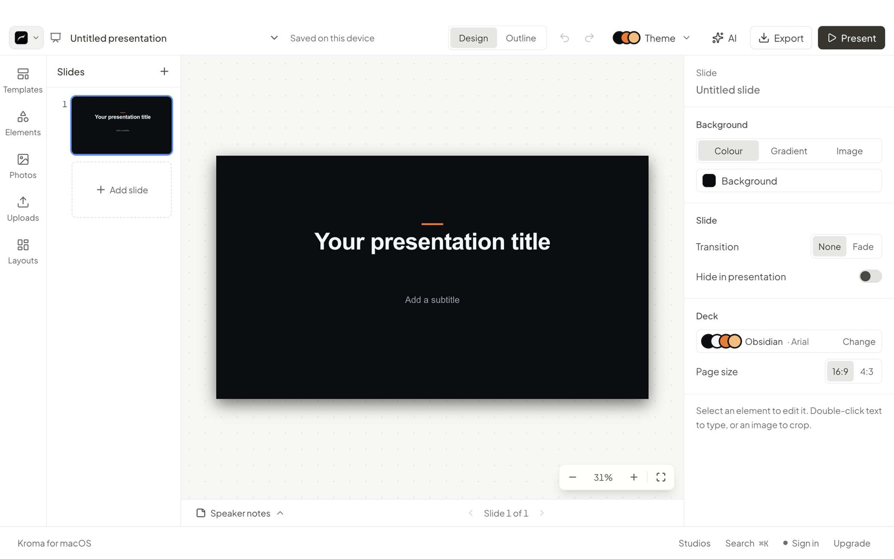

<div align="center">


# Kroma Ecosystem

**21 studios for notes, PDFs, slides and media, in one private workspace. Your files stay on your computer.**

[](https://github.com/mutlukurt/kromadesktop/releases)


[Website](https://kromaecosystem.tech) · [Use it in the browser](https://kromaecosystem.tech) · [Release notes](https://github.com/mutlukurt/kromadesktop/releases)

</div>

<br>

<p align="center"></p>

## Download

| Platform | Download | Size | Requires |
|---|---|---|---|
| **macOS** | [Kroma-2.7.0-arm64.dmg](https://github.com/mutlukurt/kromadesktop/releases/download/v2.7.0/Kroma-2.7.0-arm64.dmg) | 836 MB | Apple silicon (M1 or later), macOS 12 or later |
| **Windows** | [Kroma-Setup-2.7.0-x64.exe](https://github.com/mutlukurt/kromadesktop/releases/download/v2.7.0/Kroma-Setup-2.7.0-x64.exe) | 794 MB | Windows 10 or 11, 64-bit |

No Linux build yet. Everything also runs in the browser at [kromaecosystem.tech](https://kromaecosystem.tech).

## Install

<details open>
<summary><b>macOS</b></summary>

1. Open the DMG and drag **Kroma Ecosystem** into **Applications**.
2. Open the app once. It isn't notarized by Apple yet, so macOS says it can't verify the developer. Click **Done**.
3. Open **System Settings → Privacy & Security**, scroll to **Security** and click **Open Anyway** next to Kroma Ecosystem. You only do this once.

</details>

<details open>
<summary><b>Windows</b></summary>

1. Run the setup. It installs for your user account only, so it doesn't need administrator rights.
2. The installer isn't code-signed yet, so SmartScreen shows **Windows protected your PC**. Click **More info**, then **Run anyway**.
3. Open Kroma Ecosystem from the Start menu or the desktop shortcut. To remove it, use **Settings → Apps**.

</details>

## Verify your download

Each file's SHA-256 checksum should match exactly:

| File | SHA-256 |
|---|---|
| `Kroma-2.7.0-arm64.dmg` | `ba4a0ee777f6a1aa2239aa4116141422080728828b446751e528bf1f127df7d8` |
| `Kroma-Setup-2.7.0-x64.exe` | `5f0946c87e1255bf8fa63392cdef5137328854c40baed0d55ed2232426cceec5` |

```bash
# macOS (Terminal)
shasum -a 256 ~/Downloads/Kroma-2.7.0-arm64.dmg
```

```powershell
# Windows (PowerShell)
Get-FileHash $HOME\Downloads\Kroma-Setup-2.7.0-x64.exe
```

## What's inside

<p align="center"></p>

- **Docs**, with thousands of templates, plus **Slides** with AI decks, templates, photos and design elements
- **PDF Studio**, **Studio OCR** (Apple Vision on Mac) and **Transcribe**, using Whisper on your device
- **Reader**, **Recall** with FSRS flashcards, **Citations** and **Vault**, which encrypts files with a password only you know
- **Audio Lab** with a crash-safe 10-hour recorder, and **Screen & GIF**
- **Kroma Store**: original stickers, animations, Lottie files and design elements

## Privacy and security

- Files are processed on your computer. Cloud sync is optional and part of Pro.
- No telemetry.
- Sandboxed renderer with a strict content security policy, and links open in your own browser.
- The app can't be run as a plain Node.js runtime, and it checks its own package for tampering when it starts.
- Every Windows build is installed, opened and uninstalled on a clean Windows machine before release ([Windows install test](https://github.com/mutlukurt/kromadesktop/actions/workflows/windows-smoke.yml)).

## Support

- Website and web app: https://kromaecosystem.tech
- Email: withkromastudio@gmail.com

<sub>© 2026 Mutlu Kurt. Commercial software. All rights reserved.</sub>
