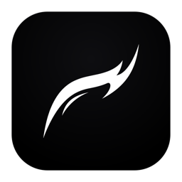
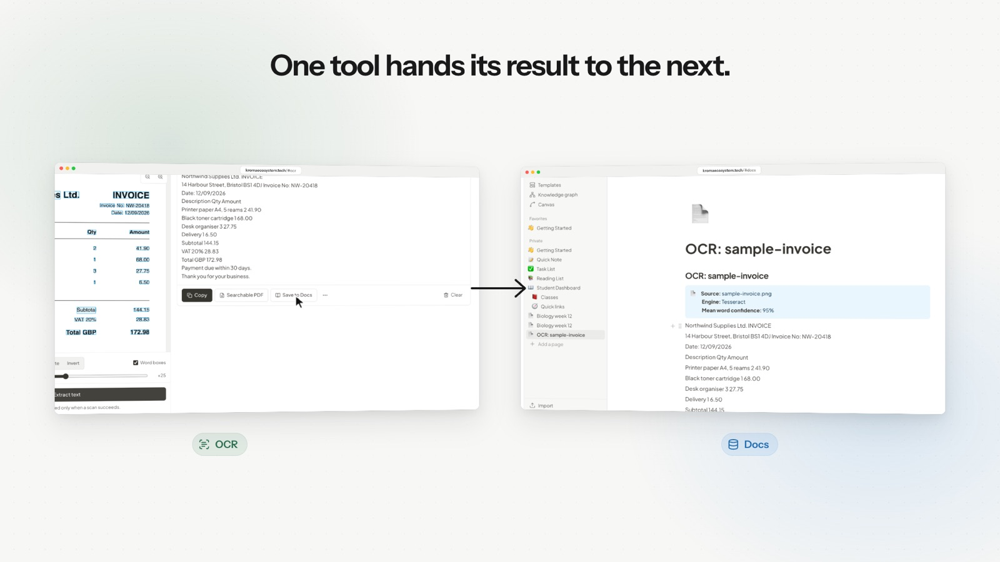
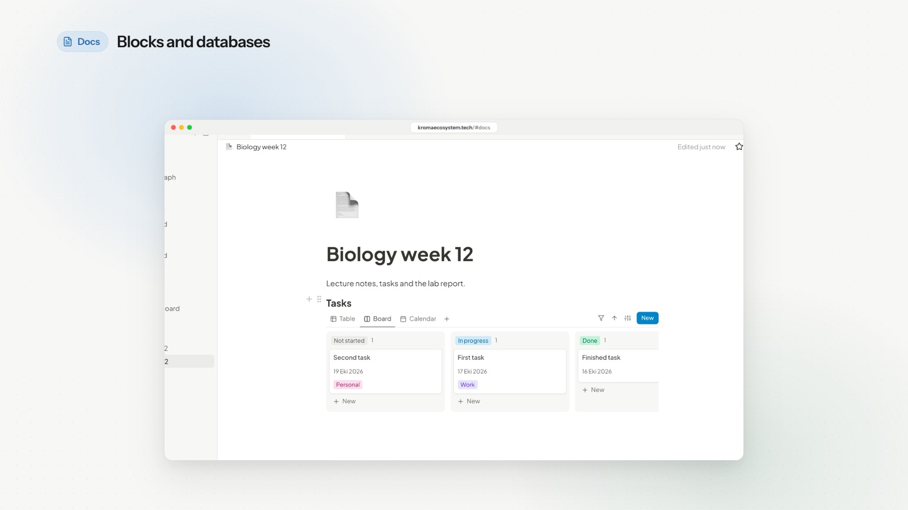
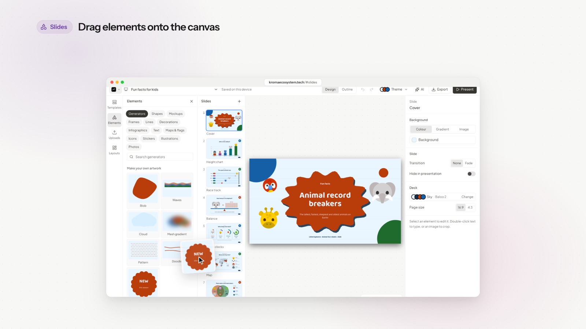
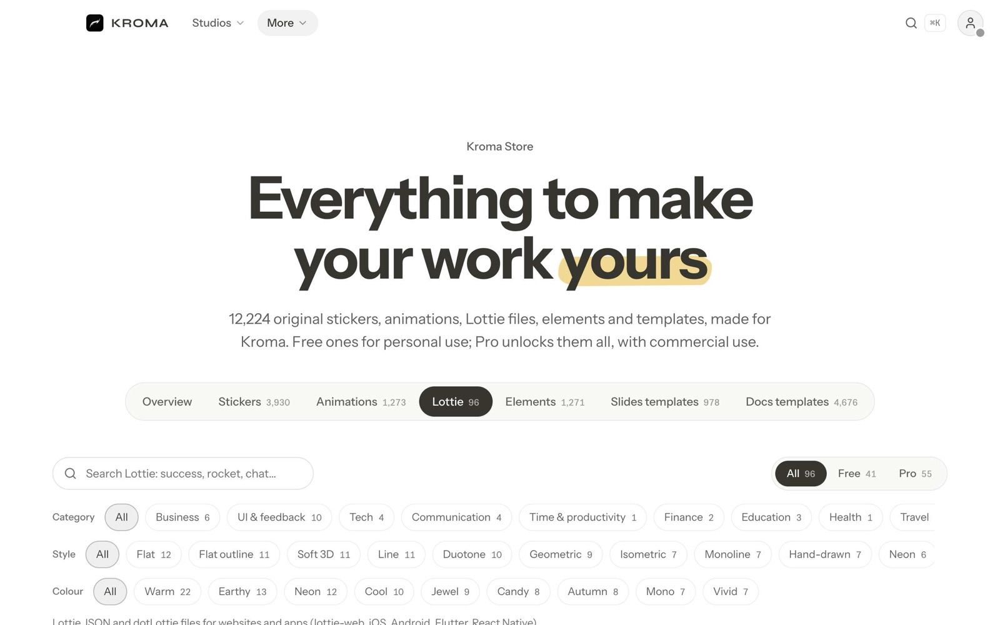
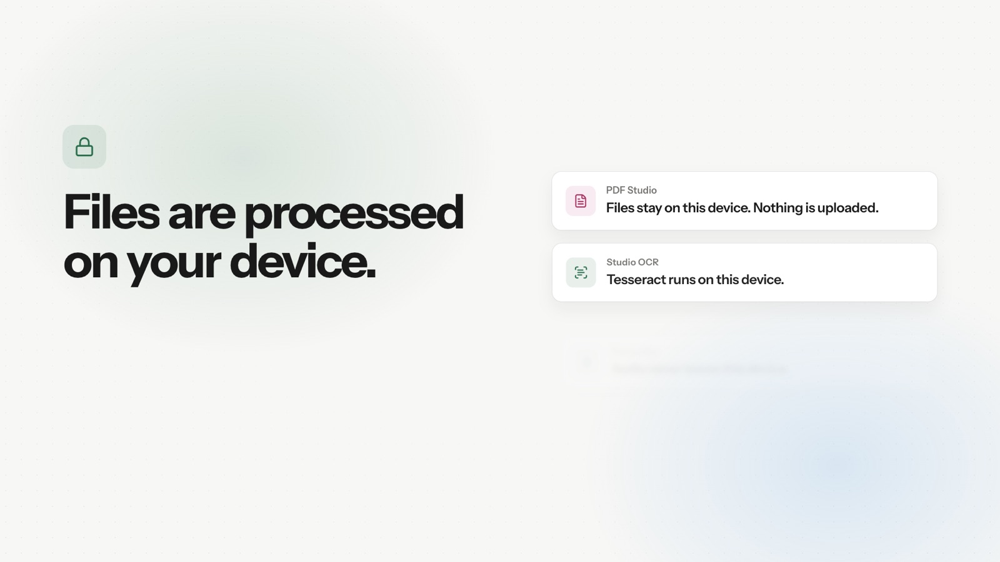

<div align="center">



# Kroma Ecosystem

**21 studios for notes, PDFs, slides and media, in one private workspace. Your files stay on your computer.**

[](https://github.com/mutlukurt/kromadesktop/releases)


**[Download for Mac](https://github.com/mutlukurt/kromadesktop/releases/download/v2.7.0/Kroma-2.7.0-arm64.dmg)** · **[Download for Windows](https://github.com/mutlukurt/kromadesktop/releases/download/v2.7.0/Kroma-Setup-2.7.0-x64.exe)** · [Use it in the browser](https://kromaecosystem.tech)

</div>

<br>

<p align="center"></p>

## One tool hands its result to the next

<p align="center"></p>

Scan an invoice in **Studio OCR** and save the text to **Docs**. Turn a PDF into notes, a recording into a transcript, a highlight in **Reader** into a flashcard in **Recall**. Every studio can pass its result to the next one.

## Docs, with blocks and databases

<p align="center"></p>

Block notes, tables, boards and calendars, a knowledge graph, and thousands of ready-made templates.

## Slides, with a design library built in

<p align="center"></p>

Hundreds of slide templates, AI decks in any language, and drag-and-drop stickers, photos, icons, charts and design elements.

## Kroma Store

<p align="center"></p>

Original stickers, animations, Lottie files, design elements and templates, made for Kroma. Free ones for personal use; Pro unlocks all of them, with commercial use.

## Files are processed on your device

<p align="center"></p>

PDF editing, OCR, image conversion and Whisper transcription run on your computer. Nothing is uploaded unless you turn on cloud sync or use Kroma AI.

## Download

| Platform | Download | Size | Requires |
|---|---|---|---|
| **macOS** | [Kroma-2.7.0-arm64.dmg](https://github.com/mutlukurt/kromadesktop/releases/download/v2.7.0/Kroma-2.7.0-arm64.dmg) | 836 MB | Apple silicon (M1 or later), macOS 12 or later |
| **Windows** | [Kroma-Setup-2.7.0-x64.exe](https://github.com/mutlukurt/kromadesktop/releases/download/v2.7.0/Kroma-Setup-2.7.0-x64.exe) | 794 MB | Windows 10 or 11, 64-bit |

No Linux build yet. Everything also runs in the browser at [kromaecosystem.tech](https://kromaecosystem.tech).

## Install

<details open>
<summary><b>macOS</b></summary>

1. Open the DMG and drag **Kroma Ecosystem** into **Applications**.
2. Open the app once. It isn't notarized by Apple yet, so macOS says it can't verify the developer. Click **Done**.
3. Open **System Settings → Privacy & Security**, scroll to **Security** and click **Open Anyway** next to Kroma Ecosystem. You only do this once.

</details>

<details open>
<summary><b>Windows</b></summary>

1. Run the setup. It installs for your user account only, so it doesn't need administrator rights.
2. The installer isn't code-signed yet, so SmartScreen shows **Windows protected your PC**. Click **More info**, then **Run anyway**.
3. Open Kroma Ecosystem from the Start menu or the desktop shortcut. To remove it, use **Settings → Apps**.

</details>

## Verify your download

Each file's SHA-256 checksum should match exactly:

| File | SHA-256 |
|---|---|
| `Kroma-2.7.0-arm64.dmg` | `4bf2b1d3a7363218b770bdc3bf1ce3959a1e7845a19f2da093aee70499f85e20` |
| `Kroma-Setup-2.7.0-x64.exe` | `5f0946c87e1255bf8fa63392cdef5137328854c40baed0d55ed2232426cceec5` |

```bash
# macOS (Terminal)
shasum -a 256 ~/Downloads/Kroma-2.7.0-arm64.dmg
```

```powershell
# Windows (PowerShell)
Get-FileHash $HOME\Downloads\Kroma-Setup-2.7.0-x64.exe
```

## All 21 studios

**Docs** · **Slides** · **PDF Studio** · **Studio OCR** (Apple Vision on Mac) · **Convert Suite** · **Transcribe** (Whisper) · **Reader** · **Recall** (FSRS flashcards) · **Citations Lab** · **Vault** · **Audio Lab** (crash-safe 10-hour recorder) · **Screen & GIF** · **Diagram Studio** · **Palette Lab** · **Kroma Compare** · **Kroma AI** and more.

## Privacy and security

- Files are processed on your computer. Cloud sync is optional and part of Pro.
- No telemetry.
- Sandboxed renderer with a strict content security policy, and links open in your own browser.
- The app can't be run as a plain Node.js runtime, and it checks its own package for tampering when it starts.
- Every Windows build is installed, opened and uninstalled on a clean Windows machine before release ([Windows install test](https://github.com/mutlukurt/kromadesktop/actions/workflows/windows-smoke.yml)).

## Support

- Website and web app: https://kromaecosystem.tech
- Email: withkromastudio@gmail.com

<sub>© 2026 Mutlu Kurt. Commercial software. All rights reserved.</sub>
